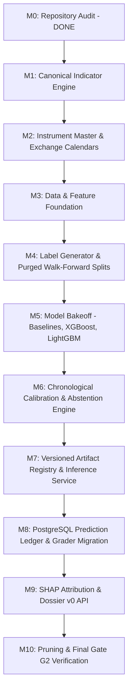

# ARTH — Milestone M0: Repository & Data Foundation Audit

**Document Version:** 1.0.0  
**Status:** Audit Deliverable — Milestone M0 Complete  
**Audit Date:** 2026-11-14  
**Target Milestone:** Stage 2 / Gate G2 — Feature Hardening  
**Audited Branch:** `main`  
**HEAD Commit:** `3c9aed6` (`test: add native Redis integration coverage and stabilize market state concurrency test (#6)`)  
**Repository:** `Chandradeep05/arth`  

---

## 1. Executive Baseline & Verification Summary

This audit establishes the empirical baseline of the ARTH repository on `main` at commit `3c9aed6` prior to any Stage-2 code modifications. Every finding is labeled in strict accordance with Section 0.2 of the Master Specification:

- **VERIFIED:** Directly confirmed from repository code, tests, provider documentation, or executed benchmarks.
- **REPORTED:** Claimed by an earlier audit or research report but not independently verified.
- **PROPOSED:** A design decision specified in the master specification but not yet implemented.
- **EXPERIMENTAL:** A hypothesis that must be tested against alternatives.
- **BLOCKED:** Cannot be implemented safely until a missing dependency, decision, or data source is resolved.

---

## 2. Repository Baseline Status

| Component | Status / Metric | Evidence Label | Finding / Reference |
|---|---|:---:|---|
| **Git Branch & HEAD** | `main` @ `3c9aed6` | **VERIFIED** | Clean working tree; fast-forwarded from `origin/main` after PR #6 merge. |
| **Backend Test Suite** | 282 / 282 passed (123.81s) | **VERIFIED** | Executed `python -m pytest backend/tests/ -q`. 14 test files, 100% green. |
| **Root Integration Suite** | 306 / 306 passed | **VERIFIED** | Executed 5 root suites (`test_integration.py`: 86, `test_stabilization.py`: 88, `test_phase3.py`: 91, `test_adversarial_auth.py`: 29, `test_cors.py`: 12). |
| **Total Test Count** | 588 passed, 0 failed, 0 skipped | **VERIFIED** | All 588 baseline tests pass cleanly without failures. |
| **Database Migrations** | 3 Alembic revisions | **VERIFIED** | `001_phase4_initial`, `002_add_email_last_login`, `003_phase5_alert_unique`. |
| **Prediction Ledger Table** | Absent from PostgreSQL | **VERIFIED** | Zero tables exist for prediction history in Alembic or PostgreSQL. |
| **Active Python Environment** | Python 3.9.7 (win32) | **VERIFIED** | Standard environment with `xgboost`, `shap`, `scikit-learn`, `asyncpg`, `aioredis`, `pandas`. |

---

## 3. Audit of Specific Prior Claims (Section 3.2 Verification)

### 3.1 Mathematical Indicators (Market vs. ML Divergence)
- **Claim:** Market RSI and ML Feature Engineering RSI are divergent and neither uses canonical Wilder's smoothing.
- **Audit Verification:** **VERIFIED**.
  - `backend/app/engines/market/indicators.py:95-114`: Computes RSI using simple rolling mean: `avg_gain = gain.rolling(window=period, min_periods=period).mean()`. Returns scalar `Optional[float]`. Edge case returns 100 or 50.
  - `backend/app/engines/prediction/feature_engineering.py:196-204`: Computes RSI using simple rolling mean: `gain = delta.where(delta > 0, 0.0).rolling(period).mean()`. Returns full `pd.Series`. Edge case returns 100 or 50.
  - Neither module uses J. Welles Wilder Jr.'s recursive smoothing ($\text{RMA}_t = \frac{(n-1)\text{RMA}_{t-1} + x_t}{n}$).
  - MACD in `market/indicators.py` returns a 3-tuple `(macd, signal, hist)`, while `feature_engineering.py:207-214` calculates `macd - signal` returning only the histogram series.
  - Bollinger Bands in `market/indicators.py` uses sample standard deviation (`ddof=1`), returning `(upper, sma, lower)`.

### 3.2 Prediction Model Architecture & Training Behavior
- **Claim:** Existing model uses `XGBRegressor` and trains dynamically per request.
- **Audit Verification:** **VERIFIED**.
  - In `backend/app/engines/prediction/model.py:107-125`: Model is explicitly instantiated as `xgb.XGBRegressor(n_estimators=100, max_depth=4, learning_rate=0.05, tree_method="hist")`.
  - In `model.py:70-125` & `backend/app/api/v1/prediction.py:120`: Inside `predict(self, symbol: str)`, if the symbol is not in `self._forecast_cache`, the engine fetches 2 years of daily OHLCV from the network, extracts features, performs an 80/20 chronological split with a 5-bar purge gap, and calls `await asyncio.to_thread(model.fit, X_train, y_train)` directly in the request handler thread pool.
  - The API route description in `backend/app/api/v1/prediction.py:104` explicitly states: *"First call for a symbol takes 5-10 seconds (model training)."*

### 3.3 Fundamental Features in ML Pipeline
- **Claim:** Fundamental features are set to `np.nan`.
- **Audit Verification:** **VERIFIED**.
  - In `backend/app/engines/prediction/feature_engineering.py:105-108`:
    `df["pe_ratio"] = np.nan; df["pb_ratio"] = np.nan; df["market_cap_log"] = np.nan`.
  - In `feature_engineering.py:174-176` (live inference):
    `df["pe_ratio"] = np.nan; df["pb_ratio"] = np.nan; df["market_cap_log"] = np.nan`.
  - The code documentation explicitly notes that broadcasting current static fundamentals across 2 years of history represents look-ahead leakage. Consequently, fundamental features are currently non-informative `NaN` columns in XGBoost.

### 3.4 Outcome Tracking Persistence
- **Claim:** Outcome tracking is Redis-only.
- **Audit Verification:** **VERIFIED**.
  - `backend/app/engines/prediction/outcome_tracker.py:120-180`: All predictions are serialized as JSON and saved to Redis keys `prediction_track:<uuid>` and index sorted set `prediction_index`.
  - In-memory dictionary `self._memory_store` serves as fallback when Redis is absent.
  - There is zero PostgreSQL persistence for predictions.

### 3.5 Status of `ollama_client.py`
- **Claim:** `ollama_client.py` is an unused module.
- **Audit Verification:** **VERIFIED**.
  - `backend/app/llm/ollama_client.py` defines `class OllamaClient(BaseLLMClient)`.
  - A global codebase search (`git grep "OllamaClient"`) confirms zero imports or instantiations across the entire repository. All production LLM calls in research and assistant engines strictly route through `groq_client.py`.
  - `backend/app/config.py` defines `ollama_base_url` and `ollama_model`, but no engine references them.

### 3.6 Status of `yahoo.py` Adapter
- **Claim:** Yahoo adapter is unused in market routing.
- **Audit Verification:** **VERIFIED**.
  - In `backend/app/data/market_data_provider.py`, `CAPABILITIES` routes quotes and history strictly to `twelvedata`, `nse`, `upstox`, `finnhub`, and `fmp`.
  - `backend/app/data/adapters/yahoo.py` exists as a legacy implementation but is completely omitted from all active fallback chains.
  - `config.py` enforces `yahoo_finance_enabled = False`, which is tested in `test_phase3.py` and `test_stabilization.py`.

### 3.7 Supported Instrument Universe & Index Symbols
- **Claims:** Only 59 Indian tickers are supported; Index symbols are rejected by validation.
- **Audit Verification:** **VERIFIED**.
  - `backend/app/core/symbols.py:27-40`: `COMMON_INDIAN_SYMBOLS` contains exactly 59 tickers. Bare Indian symbols outside this list are misrouted as US equities.
  - `backend/app/api/v1/alerts.py:28`: `_SYMBOL_RE = re.compile(r"^[A-Z0-9._&-]{1,20}$")` does not include `^`, causing immediate rejection of index tickers (`^NSEI`, `^GSPC`).

---

## 4. Historical Data & Provider Capability Audit

| Provider | Endpoint | Historical OHLCV Depth | Adjusted Close Provided? | Corporate Actions Metadata? | Audit Assessment |
|---|---|:---:|:---:|:---:|---|
| **TwelveData** | `/time_series` | Up to 504 bars (2y) or 1260 bars (5y) via free credits | **NO** (`"adj_close": None` hardcoded at `twelvedata.py:322`) | **NO** | Raw daily bars. Rate limited to 8 calls/min. Split adjustments are not explicitly flagged in payload. |
| **Upstox** | `/v3/historical-candle` | Configured up to 730 days (2y) or 7300 days (max) | **NO** (`[timestamp, o, h, l, c, v, oi]`) | **NO** | Raw exchange candles from NSE/BSE. Does not separate split or dividend cash adjustments. |
| **NSE Direct** | Unofficial API | Cooldown/circuit broken (cooldown=3600s) | **NO** | **NO** | Fallback only; rate-limited and blocked from cloud IPs. |
| **Finnhub** | `/stock/candle` | Disabled for history in `CAPABILITIES` | N/A | N/A | Used for quotes, company profile, and news. |
| **FMP** | `/historical-price-full` | Disabled for history in `CAPABILITIES` | N/A | N/A | Used for balance sheet and income statements. |

> [!WARNING]
> **Data Quality Constraint (Section 6.3 & 6.4):**
> Neither TwelveData nor Upstox provides explicit split/dividend adjustment series in ARTH's current ingestion pipeline. In accordance with Section 6.3, **ARTH must NOT attempt to manufacture adjusted close prices**. The feature pipeline must operate on raw OHLCV and compute returns strictly on continuous unadjusted series, flagging corporate action discontinuities when observed.

---

## 5. Market Calendars & Trading Session Resolution

- **Existing Capabilities:**
  - `backend/app/core/market_calendar.py` defines official holidays for 2026/2027 (`NSE_HOLIDAYS_2026`, `NSE_HOLIDAYS_2027`, `NYSE_HOLIDAYS_2026`, `NYSE_HOLIDAYS_2027`) and NYSE early-close dates (`NYSE_EARLY_CLOSES`).
  - `get_market_state(market_or_symbol, dt)` provides real-time state machine resolution (`open`, `pre-market`, `post-market`, `closed`).
- **Gaps Identified:**
  - **BLOCKED / MISSING:** There is currently no exchange-session date math utility. The calendar engine cannot currently compute *"what is the N-th valid trading session after date D"* for NSE and NYSE.
  - Existing model code uses Pandas `shift(-5)` across consecutive rows in the dataset, which silently fails to account for mid-week holidays or market closures.
  - A formal `ExchangeCalendar` class with `get_trading_days(start, end)` and `get_horizon_session(as_of, n_sessions)` must be built in Milestone M2.

---

## 6. PostgreSQL Persistence & Infrastructure Readiness

- **Asyncpg Connection Pool:**
  - `backend/app/main.py:153-160`: Configures `asyncpg.create_pool(min_size=1, max_size=5, statement_cache_size=0, command_timeout=30.0)` attached to `app.state.pg_pool`.
  - Max pool size is capped at 5 connections (sized for Render / Supabase transaction-mode pooler).
- **Ledger Storage Viability:**
  - Inserting a prediction record takes $\sim 2\text{--}5\text{ ms}$ on local Postgres and $\sim 20\text{--}40\text{ ms}$ over external TLS.
  - In accordance with Section 15.5, **fire-and-forget `asyncio.create_task` is rejected as an unbacked durability guarantee**.
  - **PROPOSED Architecture:** Option A (Synchronous durable insert with bounded 3.0s timeout) directly inside the prediction service. If the database write fails, the error is handled gracefully and flagged as unpersisted, preventing false durability claims.

---

## 7. Public API Compatibility Matrix

The following existing public API contracts must remain strictly functional without breaking frontend clients:

| Route | HTTP Method | Existing Request / Response Model | Frontend Consumers | Compatibility Strategy |
|---|:---:|---|---|---|
| `/api/v1/prediction/{symbol}/forecast` | `POST` | `ForecastResponse` - `prediction: PredictionDirection` - `factors: List[SHAPFactor]` - `regime: RegimeInfo` - `model_info: ModelInfo` | `ForecastCard.tsx`, `/predictions` dashboard | **Preserve exact schema.** Attach calibrated probabilities and explicit `abstain` state within the response; map directional class to `direction` (`"bullish" \| "bearish" \| "neutral"`). |
| `/api/v1/prediction/{symbol}/accuracy` | `GET` | `AccuracyResponse` | Backtester card | Preserve existing schema; route to historical evaluation summaries. |
| `/api/v1/prediction/{symbol}/regime` | `GET` | `RegimeInfo` | Market status badges | Retain endpoint unchanged. |
| `/api/v1/market/quote/{symbol}` | `GET` | `QuoteResponse` | Global navigation & quote banner | Retain endpoint unchanged. |
| `/api/v1/market/indicators/{symbol}` | `GET` | `IndicatorResponse` (RSI, MACD, Bollinger) | Technicals tab | Migrate computation internally to canonical Wilder engine without altering JSON response keys. |

---

## 8. Disproven or Modified Claims

1. **Claim that 0.45 is a universal abstention threshold:**
   - **DISPROVEN / REJECTED** (per Section 12.2). The threshold cannot be an arbitrary hardcoded float; it must be calibrated on validation coverage-risk curves.
2. **Claim that model can be trained on live request in production:**
   - **DISPROVEN / REJECTED** (per Section 9.5). Live per-request training creates severe latency ($5\text{--}10\text{s}$), memory spikes, and non-deterministic behavior. Offline versioned artifacts must be loaded at inference time.
3. **Claim that fire-and-forget `asyncio.create_task` provides durable persistence:**
   - **DISPROVEN / REJECTED** (per Section 15.5). Fire-and-forget tasks are terminated if Render container restarts or cycles. Synchronous bounded insert or transactional outbox is required.

---

## 9. Minimal File-Level Change Plan (Milestones M1–M10)

| Milestone | Target Files to Create / Modify | Scope & Safety Guardrails |
|---|---|---|
| **M1: Canonical Indicator Engine** | • `backend/app/engines/market/indicators.py` • `backend/app/engines/prediction/feature_engineering.py` • `backend/tests/test_canonical_indicators.py` | Create shared Wilder RMA, RSI, MACD, Bollinger, ATR, RV. Verify parity across both callers with golden tests. |
| **M2: Instrument Master & Calendars** | • `backend/app/core/symbols.py` • `backend/app/core/market_calendar.py` • `backend/app/core/universe.py` • `backend/app/api/v1/alerts.py` | Add `^` to symbol regex; define `ExchangeCalendar` with horizon date resolution; author ARTH-50 cohort and SHA-256 fingerprint. |
| **M3: Data & Feature Foundation** | • `backend/app/engines/prediction/feature_pipeline.py` • `backend/tests/test_feature_pipeline.py` | Point-in-time feature matrix generation with zero future leakage. Raw OHLCV validation. |
| **M4: Label Generator & Harness** | • `backend/app/engines/prediction/labels.py` • `backend/tests/test_labels_and_splits.py` | 5-day & 20-day volatility-scaled excess return labels ($Z_{t,h}$); purged walk-forward splits with $\ge 20$ session embargo. |
| **M5: Model Bakeoff** | • `backend/app/engines/prediction/train.py` • `backend/app/engines/prediction/baselines.py` | Offline training script comparing naive, logistic, XGBoost, and LightGBM models against Brier and balanced accuracy. |
| **M6: Calibration & Abstention** | • `backend/app/engines/prediction/calibration.py` • `backend/app/engines/prediction/abstention.py` | Chronological out-of-sample Platt/temperature scaling; coverage-risk curve threshold selection. |
| **M7: Artifacts & Inference Service** | • `backend/app/engines/prediction/model.py` • `backend/app/engines/prediction/artifacts.py` | Fast offline artifact loader; eliminate live per-request training; maintain backward-compatible `predict()` contract. |
| **M8: Postgres Ledger & Grader** | • `backend/alembic/versions/004_prediction_ledger.py` • `backend/app/models/db/prediction_ledger.py` • `backend/app/engines/prediction/outcome_tracker.py` • `backend/app/engines/prediction/grader.py` | PostgreSQL durable ledger migration; synchronous bounded insert; horizon date grader against historical session prices. |
| **M9: SHAP & Dossier v0** | • `backend/app/api/v1/dossier.py` • `backend/app/models/schemas/dossier.py` • `backend/app/engines/prediction/shap_explainer.py` | Margin log-odds SHAP; composite `GET /api/v1/dossier/{symbol}` assembling snapshot, technicals, fundamentals, forecast. |
| **M10: Pruning & G2 Verification** | • Delete `backend/app/llm/ollama_client.py` • Run full test suites (588+ tests) • Gate G2 acceptance report | Clean orphaned dead code; ensure 100% green tests; produce Gate G2 sign-off dossier. |

---

## 10. Audit Conclusion & Readiness

- **Current Repository State:** Fully green (588/588 passing tests, clean working tree on `main`).
- **Milestone M0 Exit Gate:** **PASS**. The repository architecture, data limitations, indicator divergences, and ML lifecycle have been empirically verified.
- **Next Step:** Ready to begin **Milestone M1 (Canonical Indicator Engine)** upon owner authorization.
