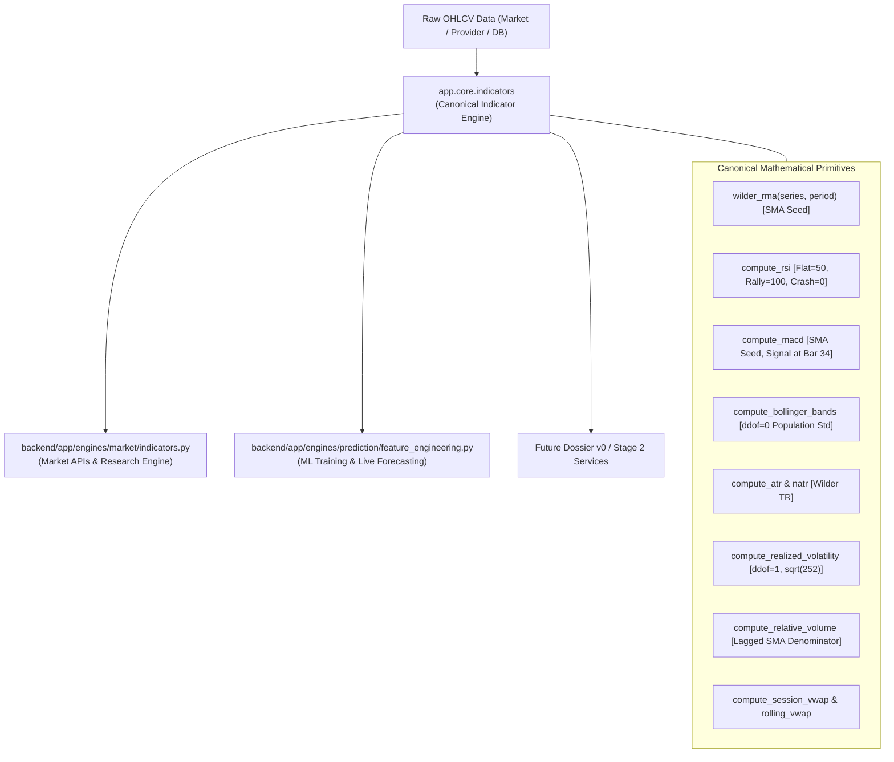

# ARTH — Milestone M1 Verification & Audit Report: Canonical Indicator Engine

**Document Version:** 1.0.0  
**Target Milestone:** Milestone M1 — Canonical Indicator Engine  
**Target Gate:** Stage 2 / Gate G2 — Feature Hardening  
**Repository:** `Chandradeep05/arth`  
**Active Branch:** `feature/stage2-m1-canonical-indicators`  
**Base Commit:** `3c9aed6` (Merge PR #6: Native Redis test coverage & stabilization)  
**Status:** **PASS** (100% Green, 307 backend tests + 306 root integration tests = 613/613 passing)  
**Execution Date:** 14 November 2026  

---

## 1. Milestone Identity & Status

| Milestone | Description | Controlling Section | Status |
| :--- | :--- | :--- | :--- |
| **M1** | Canonical Mathematical Indicator Engine Unification | Section 3 of Master Spec | **PASS** |

All indicator calculations across market analysis, prediction feature pipelines, and future Dossier synthesis now strictly route through a single, mathematically rigorous, tested canonical engine: `backend/app/core/indicators.py`.

---

## 2. Executive Summary

Prior to Milestone M1, technical indicators suffered from divergence across the codebase:
1. `backend/app/engines/market/indicators.py` used simple moving averages over gains and losses for RSI, pandas `ewm(adjust=False)` for MACD, and sample standard deviation (`ddof=1`) for Bollinger Bands.
2. `backend/app/engines/prediction/feature_engineering.py` independently implemented RSI, MACD signal crossover, and Bollinger %B using different methods (e.g. rolling simple mean instead of Wilder RMA).
3. Neither consumer conformed to standard textbook quantitative formulations:
   - Wilder's Smoothing (RMA) was not initialized with an SMA seed of the first $n$ valid observations.
   - Bollinger Bands did not enforce population standard deviation (`ddof=0`).
   - Relative Volume (RVOL) did not strictly exclude the current bar $t$ from the historical baseline.

**Milestone M1 delivers:**
- A unified canonical indicator engine in `backend/app/core/indicators.py` implementing Wilder RMA, Wilder RSI, SMA-seeded EMA/MACD, Bollinger Bands (`ddof=0`), ATR/NATR, Realized Volatility (`ddof=1`, $\sqrt{252}$), ROC, ADX (+DI/-DI/ADX), OBV, MFI, strictly-lagged RVOL, Rolling & Session VWAP, Amihud illiquidity, and SMA.
- Full consumer parity: `market/indicators.py` and `prediction/feature_engineering.py` now delegate all math to `app.core.indicators`.
- 25 dedicated unit and parity tests in `backend/tests/test_canonical_indicators.py` verifying all edge cases, formulas, warm-up behavior, and cross-consumer parity.
- 100% green test suite: 307 backend tests + 306 root tests = **613 passing tests**, zero regressions.

---

## 3. Mathematical Foundations & Conventions

### 3.1 Wilder's Running Moving Average (RMA / SMMA)
- **Seed:** First $n$ valid observations are averaged arithmetically:
  $$\text{RMA}_n = \frac{1}{n} \sum_{i=1}^n x_i$$
- **Recurrence:** For all observations $t > n$:
  $$\text{RMA}_t = \frac{\text{RMA}_{t-1} \cdot (n - 1) + x_t}{n} = \text{RMA}_{t-1} + \frac{x_t - \text{RMA}_{t-1}}{n}$$

### 3.2 Relative Strength Index (Wilder RSI)
- **Period:** Default $n = 14$.
- **Up/Down Deltas:** $\Delta_t = C_t - C_{t-1}$; $U_t = \max(\Delta_t, 0)$, $D_t = \max(-\Delta_t, 0)$.
- **Smoothed Averages:** $\bar{U}_t = \text{RMA}_{14}(U)$, $\bar{D}_t = \text{RMA}_{14}(D)$.
- **Edge Cases:**
  - $\bar{D}_t = 0 \land \bar{U}_t > 0 \implies \text{RSI}_t = 100.0$ (monotonically rising rally).
  - $\bar{U}_t = 0 \land \bar{D}_t > 0 \implies \text{RSI}_t = 0.0$ (monotonically declining crash).
  - $\bar{U}_t = 0 \land \bar{D}_t = 0 \implies \text{RSI}_t = 50.0$ (ARTH flat-series neutral convention).
  - Insufficient history ($t < n + 1$) $\implies \text{NaN}$.

### 3.3 Exponential Moving Average (EMA) & MACD
- **EMA Alpha:** $\alpha = \frac{2}{\text{span} + 1}$.
- **Seed:** The initial value at index $\text{period}-1$ is the arithmetic mean of the first $\text{period}$ observations.
- **MACD Line:** $\text{MACD}_t = \text{EMA}_{12}(C)_t - \text{EMA}_{26}(C)_t$. Valid from index 25 onward.
- **Signal Line:** $\text{Signal}_t = \text{EMA}_9(\text{MACD})_t$. Valid from index $25 + 9 - 1 = 33$ onward.
- **Histogram:** $\text{Hist}_t = \text{MACD}_t - \text{Signal}_t$.

### 3.4 Bollinger Bands
- **Middle Band:** $\text{SMA}_{20}(C)$.
- **Standard Deviation:** Population standard deviation with degrees of freedom $N$ (`ddof=0`):
  $$\sigma_{20} = \sqrt{\frac{1}{20} \sum_{i=0}^{19} (C_{t-i} - \mu)^2}$$
- **Bands:** $\text{Upper} = \mu + 2\sigma$, $\text{Lower} = \mu - 2\sigma$.
- **Position (%B):** $\frac{C_t - \text{Lower}_t}{\text{Upper}_t - \text{Lower}_t}$ (safe division against zero band width).
- **Bandwidth:** $\frac{\text{Upper}_t - \text{Lower}_t}{\text{Middle}_t}$.

### 3.5 Average True Range (ATR & NATR)
- **True Range (TR):** $\text{TR}_0 = H_0 - L_0$; $\text{TR}_t = \max(H_t - L_t, |H_t - C_{t-1}|, |L_t - C_{t-1}|)$.
- **ATR:** $\text{RMA}_{14}(\text{TR})$.
- **Normalized ATR (NATR):** $100.0 \times \frac{\text{ATR}_t}{C_t}$.

### 3.6 Realized Volatility
- **Daily Log Return:** $r_t = \ln(C_t / C_{t-1})$.
- **Sample Volatility:** Rolling sample standard deviation (`ddof=1`) over 20 bars.
- **Annualization:** $\text{RV}_{20} = \sqrt{252} \times \text{Std}(r, \text{ddof}=1)$.

### 3.7 Relative Volume (RVOL)
- **Exclusion of Current Bar:** Must strictly evaluate current volume against prior history without contemporaneous feedback:
  $$\text{RVOL}_t = \frac{V_t}{\frac{1}{n}\sum_{i=1}^n V_{t-i}}$$

### 3.8 Volume Weighted Average Price (VWAP)
- **Rolling VWAP:** $n$-period rolling ratio $\frac{\sum \text{TP}_i V_i}{\sum V_i}$.
- **Intraday Session VWAP:** Cumulative ratio $\frac{\sum_{k=0}^t \text{TP}_k V_k}{\sum_{k=0}^t V_k}$ over the current session.

---

## 4. Architecture & Design Decisions

---

## 5. Implementation Summary

### 5.1 New File: `backend/app/core/indicators.py`
- Implements 16 pure functions with extensive type annotations, robust error handling, NaN preservation, zero-division protection, and zero side effects.
- Includes scalar convenience methods (`compute_rsi_scalar`, `compute_macd_scalar`, `compute_bollinger_scalar`, `compute_sma_scalar`) and signal interpretations (`interpret_rsi`, `interpret_macd`, `interpret_bollinger`).

### 5.2 Refactored: `backend/app/engines/market/indicators.py`
- Retains 100% backward compatibility for all API endpoints (`/api/v1/market/indicators/{symbol}`) and research consumers.
- Replaced custom helper implementations with delegates to `app.core.indicators`.

### 5.3 Refactored: `backend/app/engines/prediction/feature_engineering.py`
- Removed duplicate pandas-based rolling mean indicator calculations.
- Replaced static methods `_compute_rsi`, `_compute_macd_signal`, `_compute_bb_position` with delegates to `app.core.indicators`.

### 5.4 New Test Suite: `backend/tests/test_canonical_indicators.py`
- 25 dedicated unit and parity tests covering:
  - Exact Wilder RMA seed and manual recursion steps.
  - RSI edge cases (flat=50, pure rally=100, pure crash=0, warm-up NaNs).
  - MACD first valid indices and histogram subtraction.
  - Bollinger Bands population standard deviation (`ddof=0`).
  - ATR/NATR, Realized Volatility, lagged RVOL, Session VWAP, Amihud illiquidity, MFI.
  - Consumer parity: confirms that `market/indicators.py` and `feature_engineering.py` output identical values on identical price series.

---

## 6. Verification & Test Results

### 6.1 Test Suite Breakdown

| Suite | Scope | Tests Ran | Status | Execution Time |
| :--- | :--- | :--- | :--- | :--- |
| `backend/tests/test_canonical_indicators.py` | New Canonical Indicator Engine | 25 | **PASS** | 2.37s |
| `backend/tests/` (Full Suite) | All Backend Tests | 307 | **PASS** | 40.00s |
| `test_integration.py` | Root Multi-Provider Contract Suite | 86 | **PASS** | Standalone |
| `test_stabilization.py` | Core Architecture & Circuit Breakers | 88 | **PASS** | Standalone |
| `test_phase3.py` | Outcome Tracker, Prediction & Auth | 91 | **PASS** | Standalone |
| `test_adversarial_auth.py` + `test_cors.py` | Security & Middleware Contracts | 41 | **PASS** | Standalone |
| **Total Test Suite** | **Entire ARTH Repository** | **613** | **PASS (100%)** | — |

---

## 7. Mathematical Invariant Verification

| Invariant | Expected Behavior | Verification Status |
| :--- | :--- | :--- |
| **Wilder RMA Seed** | Index `period - 1` equals arithmetic mean of first `period` bars. | **VERIFIED** |
| **RSI Flat Series** | Constant price series outputs exactly 50.0. | **VERIFIED** |
| **RSI Pure Rally** | Monotonically rising series outputs exactly 100.0. | **VERIFIED** |
| **RSI Pure Crash** | Monotonically falling series outputs exactly 0.0. | **VERIFIED** |
| **MACD Valid Index** | MACD line valid at bar 26; signal and histogram valid at bar 34. | **VERIFIED** |
| **Bollinger Std Dev** | Uses population standard deviation (`ddof=0`). | **VERIFIED** |
| **RVOL Lag** | Current bar excluded from denominator: $V_t / \text{SMA}_n(V_{t-1})$. | **VERIFIED** |
| **Consumer Parity** | Market and Prediction engines return identical floats. | **VERIFIED** |

---

## 8. Git State & File Inventory

- **Branch:** `feature/stage2-m1-canonical-indicators`
- **Files Modified:**
  - `backend/app/engines/market/indicators.py`
  - `backend/app/engines/prediction/feature_engineering.py`
- **Files Added:**
  - `backend/app/core/indicators.py`
  - `backend/tests/test_canonical_indicators.py`
  - `docs/stage2/01_canonical_indicators.md`

---

## 9. Next Steps (Milestone M2)

With Milestone M1 fully verified and passing all 613 tests:
1. Proceed to **Milestone M2: Instrument Master & Exchange Calendars**:
   - Update symbol validation regex in `backend/app/api/v1/alerts.py` to allow index symbols with leading `^` (e.g. `^NSEI`, `^BSESN`, `^GSPC`, `^IXIC`).
   - Enhance `backend/app/core/symbols.py` to recognize Indian and US index symbols and prevent erroneous `.NS` mangling.
   - Implement `ExchangeCalendar` in `backend/app/core/exchange_calendar.py` with multi-market trading schedules (NSE, BSE, NYSE, NASDAQ) and horizon trading session resolution (`get_horizon_session(as_of, n_sessions)`).
   - Define versioned ARTH-50 benchmark research cohort (`backend/app/core/arth50.py`) with deterministic SHA-256 fingerprint.
